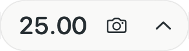
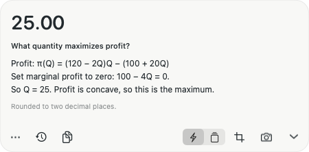

<p align="center"></p>

# Lens

Lens is a small macOS menu bar app that sends screenshots to Codex CLI and shows short answers with explanations. Send one screenshot immediately or queue several and send them together.

**[Download Lens](https://github.com/constantineserkov/lens-app/releases/latest)** · macOS 14+ · Apple Silicon and Intel · [MIT](LICENSE)

<p align="center">
  
  <br>
  <em>Collapsed: the answer at a glance.</em>
</p>

<p align="center">
  
  <br>
  <em>Expanded: the same answer with its explanation.</em>
</p>

## Getting started

1. Download and unzip the universal macOS archive from the release page. Move `Lens.app` to Applications and open it. The Lens icon appears in the menu bar.
2. Install and sign in to [Codex CLI](https://developers.openai.com/codex/cli/). Your account needs access to `gpt-6.1-sol`. If Lens cannot find the CLI, set its path in Settings.
3. To capture your screen, grant Lens screen recording permission in macOS System Settings. Importing images does not require this permission.

The release is ad hoc signed and is not notarized by Apple. If macOS blocks the downloaded app, [build from source](#build-from-source).

## Using Lens

| Action | Shortcut |
| --- | --- |
| Capture the full screen | ⌃⌥3 |
| Capture a region | ⌃⌥4 |
| Show or hide the panel | ⌃⌥L |

- The **lightning bolt** sends the screenshot immediately. The **stack** queues screenshots until you select **Send All**. Use **Open Image…** in the **⋯** menu to import an existing image.
- Batch results show a list of short answers first. Select a question to expand its explanation. Completed batches remain in History, and the screenshot queue survives a restart.
- Use the chevron to collapse the panel. Drag the panel to move it, or drag its edge to resize it when expanded.

## Data

Lens sends the images you submit and your answer format preferences through your signed-in Codex CLI. Queued screenshots and answer history are stored on your Mac in `~/Library/Application Support/Lens/`. Screenshots are removed from the queue after successful processing and saving.

## Build from source

You need macOS and the Xcode Command Line Tools (`xcode-select --install`).

```sh
git clone https://github.com/constantineserkov/lens-app.git
cd lens-app
./build.sh
open Lens.app
```

Use `./build.sh --universal` to build for both architectures. After a universal build, `./package.sh` writes the ZIP archive and `SHA256SUMS.txt` to `dist/`.

Run `./test.sh` to check the queue, history, panel geometry, and retry behavior using a simulated CLI. After building, `python3 test_live.py` and `python3 test_batch_live.py` optionally check the app with a signed-in Codex CLI.
